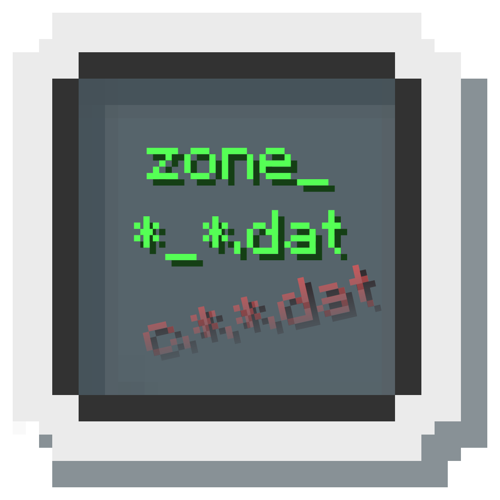

<h1 style="padding-top: 0;">ZonifiedBeta</h1>

A small mod to use the previously unused ZonedChunkStorage present in b1.2_02-20110517

> [!NOTE]
> The Zone File Format has many flaws, one of which causes "chunk saving issues" due to how the filenames are generated (in reality, the chunks are saved, but the flawed code doesn't always load them)
>
> Outside of the 'corruption bug', one of the main issues you will find is that a single world can quickly eat hundreds of MB to even GB of space.
> This is due to the fact that Zone files are completely uncompressed.
>
> The filename issue is fixed via the LoadZone mod, which you can download [here](https://modrinth.com/mod/LoadZone). [(View Sources)](https://github.com/Team-Lodestone/LoadZone)   
> More info about the filename bug can also be found at the LoadZone README.

##### Companion mods
- [LoadZone](https://modrinth.com/mod/LoadZone) ([View Source](https://github.com/Team-Lodestone/LoadZone))
  - Fixes zone filenames which patches a critical chunk loading bug
- [NotSoSecret](https://modrinth.com/mod/NotSoSecret) ([View Source](https://github.com/DexrnZacAttack/NotSoSecret))
  - Disables Notch's SecretMode test code that forcefully drags the player into the `secretLevel` on load.
  - Also fixes the inventory bind not existing

#### Installation
- Download the mod from the releases
  - Theoretically, the mod SHOULD work between Fabric-based loaders, as there is no dependency on the OSL itself, and b1.2_02-20110517 is already deobfuscated.
  - This has not been tested though. Should it not work on your loader, please continue with the installation steps yourself.
- **Instructions still need to be written for this as Ornithe does not currently support `b1.2_02-20110517` outside of an experimental devenv made by somebody else.**

### *What's different?*
After the Zone file format was introduced in inf-20100624, Notch and the playerbase had found serious issues that made the format unusable in its current state.
Because of this, it was reverted in the very next update to the Alpha Save Format.

However, the Zone format and the code to use it were still present in the codebase at the time this b1.2 dev build was compiled.

This mod forces the game to use this 'Zone save format' (known as `ZonedChunkStorage` in code) instead of the Alpha Save Format (known as `OldChunkStorage` in code)

<figure>
  
  <figcaption>A warning screen that appears when the user attempts to load a world which uses ZonifiedBeta, without ZonifiedBeta installed. Click the image to watch a showcase video of LoadZone, ZonifiedBeta, and NotSoSecret on YouTube</figcaption>
</figure>

> [!IMPORTANT]
> Worlds created with ZonifiedBeta will not properly load on vanilla clients due to the fact that there is no converter unlike AFS→McRegion.
>
> Likewise, worlds created in vanilla are NOT compatible with clients running ZonifiedBeta.
>
> Loading a ZonifiedBeta world on vanilla and vice versa is most likely to cause the player to spawn in a wall, or up in the sky.  
> This is because the game's `ChunkStorage` looks for files using its respective save format structure, and when they're not found it will then generate new chunks.  
> The chunk that generates at the player's last logout position might not be the same, so if you logged off in your house, the chunks that generate around the same position may actually form say a mountain instead, and the player will then spawn inside the mountain and suffocate to death.
>
> To help prevent accidental loading, ZonifiedBeta checks for a marker file (`.zonifiedbeta`) before loading a world to determine whether it is safe to load.
> In the event the file does not exist (such as the world being vanilla), the player is notified that they are about to load a vanilla world, and is given the option to cancel.

### *But, what **are** zones?*
It is essentially McRegion before McRegion, with the format being written by Notch during the Infdev era of Minecraft.

More info can be found at the [Minecraft Wiki page for the Zone File Format](https://minecraft.wiki/w/Zone_file_format), which was previously mostly undocumented before our discoveries during the development of libLodestone.
